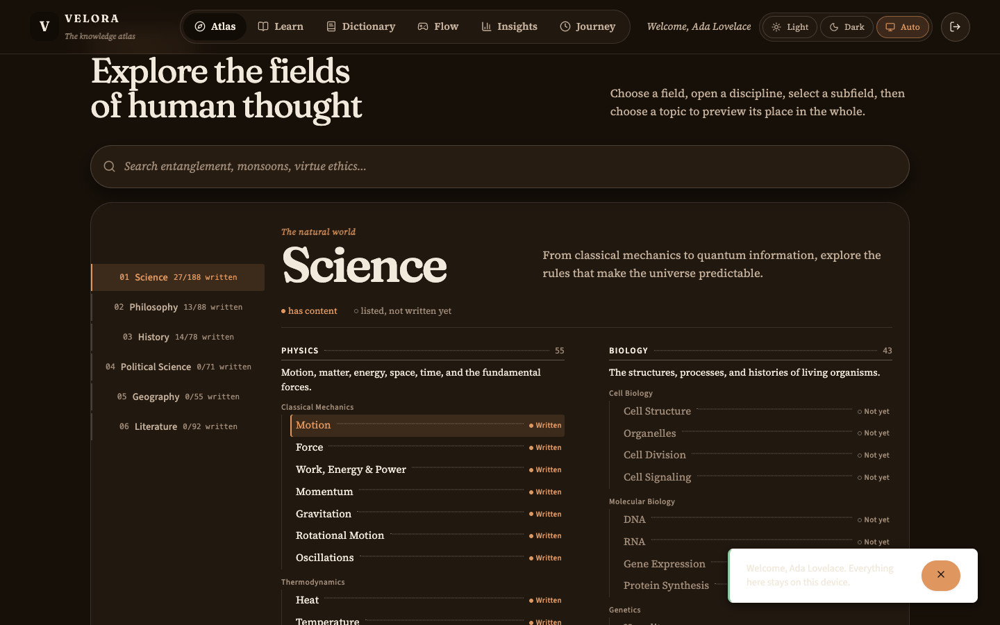
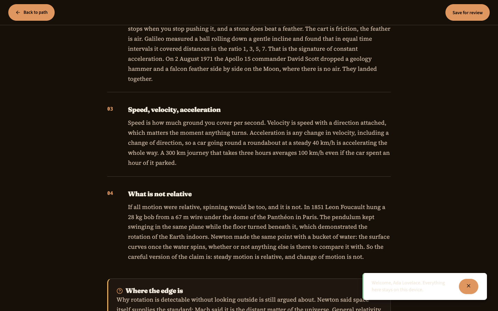
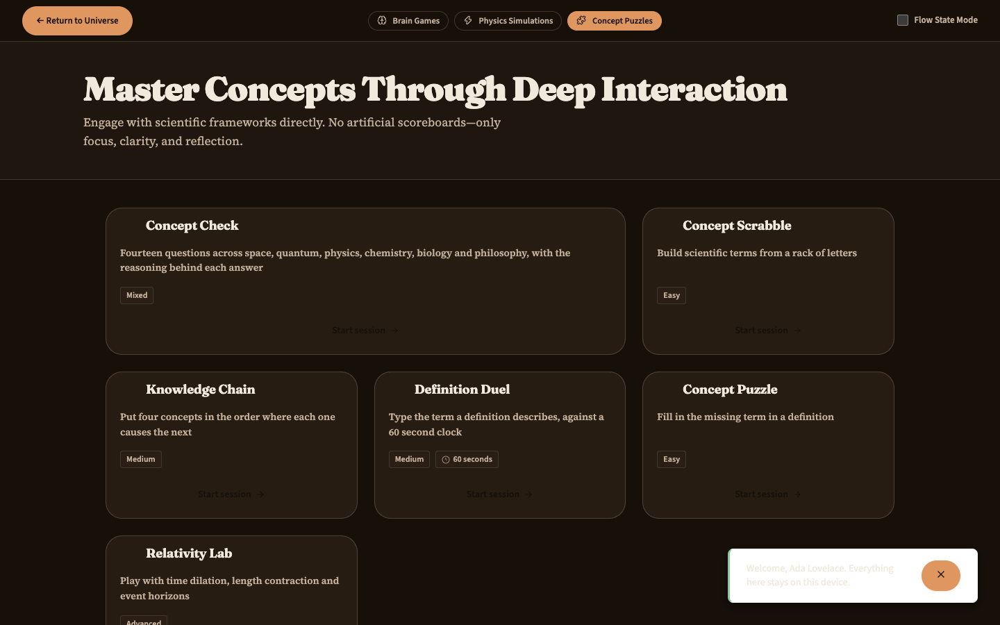
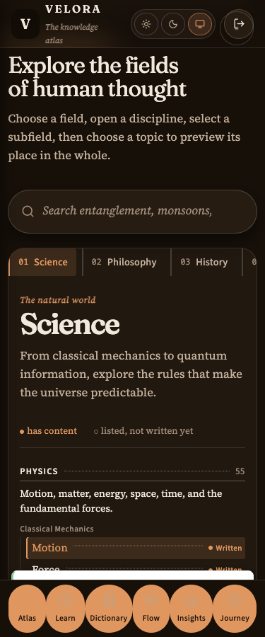

# Velora

**Every concept written from scratch, in plain human language. No account, and
nothing leaves your browser.**

Velora is a free, reference-book-style web app for curious people aged 15 to 80.
It covers Physics, Philosophy, History, Computer Science, and a Smart Dictionary.
It was built because I tutor kids who memorize facts for a test and forget them
a week later. I wanted a place where explaining *why* matters as much as the
fact itself.

---

### See it running

- **Live demo:** https://toibawani.github.io/velora (deploys automatically on push to main)
- **CI:** [](https://github.com/toibawani/Velora/actions/workflows/ci.yml)









---

## How to run it

```bash
git clone https://github.com/toibawani/velora.git
cd velora
npm ci
npm start
```

There are no environment variables and no backend. The app reads its content
from files inside this repository. If a text editor opens, that is a mistake,
not a setup hint.

---

## What is written, and what is not

The Atlas indexes 573 topics across nine subjects. Only 88 philosophy topics
have entries written behind them. Every unwritten topic shows as "not written
yet" instead of a half-finished page. The counters below are read from the
data files, not estimated.

| Counter | Value |
|---|---|
| Dictionary entries | 138 |
| Black hole levels | 8 levels, 61 entries |
| Games | 5 |
| Atlas topics (total / written) | 573 / 88 |
| Subjects | 9 |

### Not done yet

- The other eight subjects have no written topics. Only philosophy has entries
  right now. This is by choice: a short honest list beats a long fake one.
- No backend. All state is local to the browser, in localStorage.
- No accounts, no logins, no servers.
- The games are content audits, not fully built products. They play and report;
  they do not judge.

---

## Stack

- React 19, bundled with Create React App (parked bundler)
- TypeScript for the data layer, none for the UI
- CSS custom properties for design tokens
- Puppeteer Chrome for audits

---

## Read the design decisions

[docs/DECISIONS.md](docs/DECISIONS.md) - what I chose, what I rejected, and why.
README.md is a brochure. DECISIONS.md is a record.
