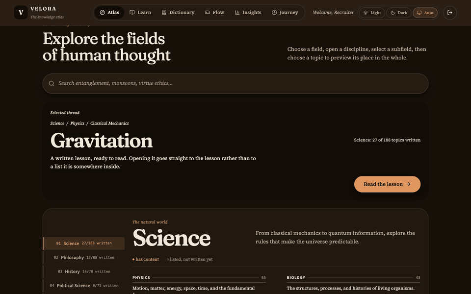

# Velora

**A reference book for curious people. 54 of its 572 topics have a lesson or a
deep read behind them. The other 518 say so.**

## If you have 60 seconds

1. Open **[toibawani.github.io/Velora](https://toibawani.github.io/Velora/)**.
2. Click **Look around first** if you want the inventory before the app asks for
   a name, or **Start learning** to go straight in. The name stays in your
   browser; there is no email, password or account.
3. On the atlas, the selected topic sits at the top with a **Read the lesson**
   button. Try Gravitation, then tap the dotted word **spacetime** in section 04
   for an inline definition.



Three things that are not the usual demo:

- **Unwritten topics are visible.** The index marks every topic as written or
  "not written yet". Three of the six fields have no curriculum yet and the
  atlas says so instead of opening a placeholder page.
- **There is no backend.** All content is in this repository and all state is in
  localStorage. Nothing is sent anywhere, and there is no account to create.
- **The checks are proven to fail.** Each gate was broken on purpose and watched
  going red before it was trusted. See [the case study](docs/CASE-STUDY.md) for
  three of them, with commit hashes.

The full tour, including the parts that are still rough, is in
[docs/CASE-STUDY.md](docs/CASE-STUDY.md). The design choices are in
[docs/DECISIONS.md](docs/DECISIONS.md).

---

## Engineering highlights

Every number here was produced by `node scripts/by-the-numbers.js`, which reads
the data files, compiles the real Atlas resolver, runs jest, and parses the
workflow files. Run it and compare.

| What | Measured value |
|---|---|
| Jest suites / tests | 82 suites, 682 tests, all passing |
| Atlas topics with content | 54 of 572 |
| Fields / disciplines | 6 fields, 34 disciplines |
| Dictionary entries | 138, every one with a source URL |
| Black hole deep read | 8 levels, 61 entries |
| Games / simulations | 8 games (5 concept, 3 brain), 6 simulations |
| CI jobs / checks | 4 jobs, 8 checks (7 real-Chrome audits and the contrast gate) |
| Lighthouse, mobile | performance 99, accessibility 100, best practices 100, SEO 100 |
| Lighthouse measured | 18 October 2026, Lighthouse 12.2.1, [docs/lighthouse.json](docs/lighthouse.json) |

```bash
node scripts/by-the-numbers.js        # prints all of the above
./scripts/measure-lighthouse.sh       # re-measures the deployed site
```

The 8 CI checks are not decoration. They drive the built app in real Chrome at
1440 and 375, walk every screen, open and play every game, probe every atlas
field, verify every black hole level, and fail on a console error. The contrast
gate composites the design tokens and fails below WCAG AA.

Two of the suites check the checks: `src/fabricatedScreens.test.js` fails if a
screen prints a number it cannot measure or a person it cannot see, and
`src/auditCoverage.test.js` fails if an audit stops exercising what it claims
to exercise.

---

## What is written, and what is not

The Atlas lists 572 topics across six fields. 54 resolve to a lesson or a deep
read. 300 resolve to "not written yet". The remaining 218 sit in Political
Science, Geography and Literature, which are listed in full with no curriculum
behind them yet.

| Counter | Value |
|---|---|
| Atlas topics (total / written) | 572 / 54 |
| Fields / disciplines | 6 / 34 |
| Dictionary entries | 138 |
| Black hole levels | 8 levels, 61 entries |
| Games (concept + brain) | 8 (5 + 3) |
| Simulations | 6 |

### Not done yet

- Political Science, Geography and Literature have no written topics. The
  topics are listed so the gap is visible, not hidden.
- Science, Philosophy and History are partly written. The index shows the exact
  count per field.
- No backend and no accounts. Clearing site data removes your progress.
- The games play and report; they are content audits, not finished products.

---

## How to run it

```bash
git clone https://github.com/toibawani/Velora.git
cd velora
npm ci
npm start
```

There are no environment variables. The app reads its content from files in this
repository.

To run what CI runs:

```bash
npx tsc --noEmit
CI=true npx react-scripts test --watchAll=false
npm run build
npm run lint
node scripts/checkContrast.js
npm run test:layout        # then naming, games, a11y, atlas-topics, atlas-tap, levels
```

The browser audits need Chrome. `scripts/chrome.js` finds it, or set
`CHROME_PATH`.

---

## Stack

- React 19, bundled with Create React App (a bundler I plan to replace; see
  [docs/issues/002-cra-parked-bundler.md](docs/issues/002-cra-parked-bundler.md))
- TypeScript for the data layer, plain JavaScript for the UI
- CSS custom properties for every colour, spacing and type token
- Puppeteer and real Chrome for the audits
- GitHub Actions and GitHub Pages, no other services

---

## The rest of the docs

- [docs/CASE-STUDY.md](docs/CASE-STUDY.md): three real bugs, with hashes and measurements
- [docs/DECISIONS.md](docs/DECISIONS.md): what I chose, what I rejected, and why
- [docs/GOOD-FIRST-ISSUES.md](docs/GOOD-FIRST-ISSUES.md): five open issues in projects I use
- [docs/DEMO-SCRIPT.md](docs/DEMO-SCRIPT.md): the 90-second walkthrough, in plain words

---

## More from me

- GitHub: [github.com/toibawani](https://github.com/toibawani)
- Portfolio: [toibawani.github.io/toiba-portfolio](https://toibawani.github.io/toiba-portfolio/)
- The longer write-up of what broke and why: [docs/CASE-STUDY.md](docs/CASE-STUDY.md)
